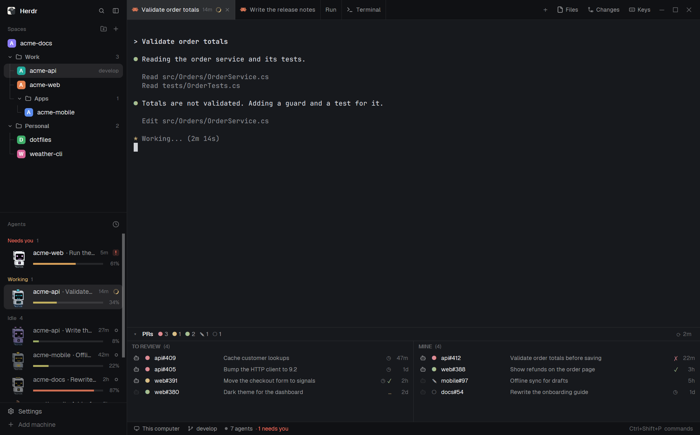

# herdr-mods

Mods and a layout for the [Herdr](https://herdr.dev) desktop app. This is how one person set up their Herdr, shared as inspiration: take one mod, take a few, or have your agent build your own version of one. Nothing here expects to be installed as a whole.



## The mods

| | | Needs |
|---|---|---|
| [**Agent Cards**](agent-cards) | The Agents list as cards: a robot per agent, a context bar, a timer. Agents idle for 16 hours go to sleep. | |
| [**Timed Tabs**](timed-tabs) | The tab bar with a timer on every tab whose agent is working, flat tabs and a marker while you drag. | |
| [**Space Folders**](space-folders) | The Spaces list as a tree: spaces in folders that nest and fold. | Project Picker |
| [**Project Picker**](project-picker) | Press a key, type a few letters, Enter: a project opens as a space with your agent running. | |
| [**Shortcuts**](shortcuts) | A panel with every keyboard shortcut of your Herdr, in plain words, with a filter. | Timed Tabs |
| [**Run Configurations**](run-configurations) | A Run tab that starts your JetBrains run configurations and follows the output of each process. Windows only. | Timed Tabs |
| [**PR Inbox**](pr-inbox) | Your open pull requests under the terminals, flagged by whose turn it is, with an agent one click away. | GitHub CLI |
| [**Borderless Layout**](borderless) | Herdr's main layout with everything flush, and a place for each mod above. | |

Each folder has a `README.md` with pictures, how to set it up and how to use it.

## Install

### With your agent

Herdr's agents know how to add a mod from a GitHub folder. Ask the one in your Herdr window:

> Read ~/.config/herdr-app/AGENTS.md, then add this mod: https://github.com/Cerbrus/herdr-mods/tree/master/agent-cards

Each mod's README has the sentence to use for it. To look at the whole set and pick:

> Read ~/.config/herdr-app/AGENTS.md, then add this layout: https://github.com/Cerbrus/herdr-mods/tree/master

The agent goes through the list with you, asks which mods you want, whether you want the layout, and what each mod needs to know from you. Nothing is installed until you have answered. The `RECIPE.md` at the top of the repository tells it to do so even when you ask for "all the mods".

You can also ask for a variation: "like Agent Cards, but with pixel art people" or "the PR Inbox, but for GitLab". The recipes describe each mod well enough for an agent to build it differently.

For a mod you chose, the agent reads the `RECIPE.md` of the folder and every file in it, tells you what the mod runs or fetches, copies it into `~/.config/herdr-app/mods`, adds its keys to your `keys.json` and checks that it loads. Your own layout and keys stay as they were unless you ask for a change.

### With PowerShell

Clone the repository anywhere, then:

```powershell
.\Install.ps1                                # everything, with the layout, without asking
.\Install.ps1 agent-cards, pr-inbox -Layout  # two mods, in the Borderless Layout
.\Install.ps1 project-picker -Rebind         # one mod, in your own layout
.\Install.ps1 -List                          # the items and what each needs
```

Non-elevated and idempotent: run it again after a `git pull` to update. What a mod needs is installed with it.

- **`-Layout`** also installs the Borderless Layout, fitted to what you have: a place whose mod is not installed shows Herdr's own version or is left out. Once the layout is there, every later install fits it again. Switch to it with `ctrl-shift-l`.
- **Without `-Layout`** a mod is installed but shows nowhere until a layout names it: `"content": { "mod": "agent-cards" }` in a block of your own layout.
- **`-Rebind`** lets a mod take a key that already does something else. That is only `ctrl-shift-n`, which Herdr binds to "New space" and the Project Picker wants. Without it the key is reported and left alone.

## Yours to fill in

Three mods need to know something about you. Each keeps it in a `config.js` in its own folder under `~/.config/herdr-app/mods`, which is copied once and never overwritten by an update:

| Mod | What to fill in |
|---|---|
| Project Picker | Where your projects are, and what a new space starts |
| PR Inbox | The GitHub organisation, which repositories, where your projects are |
| Space Folders | Optional: folders to start with |

Saving the file applies it at once.

## What the mods touch

Mods are trusted code that runs as you. These reach beyond Herdr:

- **Agent Cards** fetches one avatar per agent from `api.dicebear.com`, sending a hash of the space and tab name.
- **PR Inbox** asks GitHub for your pull requests through `gh`, every five minutes.
- **Run Configurations** starts the programs your run configurations name, when you press Run.

The rest only reads: `git`, and folder listings through `cmd`, `powershell` or `sh`.

## After a Herdr update

Agent Cards, Timed Tabs, Space Folders, the `+` menu of Run Configurations and everything in the Borderless Layout are clones of what Herdr 0.1.16 ships. Herdr never updates a clone, so its own changes are merged in here. To get them: update Herdr, pull this repository, install again.

Maintaining the clones:

```powershell
.\Merge-Upstream.ps1 -Check    # what changed, and how it would merge
.\Merge-Upstream.ps1           # merge it into the clones in the repo
```

`upstream/` holds every shipped file a clone was made from, as it was when the clone was last brought up to date. A changed file is merged into its clone with a three-way merge (`git merge-file`), the copy in `upstream/` is renewed and the clone's `cloned_from` version is raised. `Install.ps1` runs the merge first and skips a file that still has conflict markers.

## Changing a mod

Herdr reloads a mod when its file is saved, so edit the installed file, check it, then pull it into the repository:

```powershell
herdr-app check $HOME\.config\herdr-app\mods\space-folders
.\Install.ps1 -Pull
```

`-Pull` copies the installed files back over the repository's copies, including new `.js`, `.json` and `.svg` files of a mod that is already here. `config.js` files stay where they are. `CLAUDE.md` has the rules for working on the mods.
