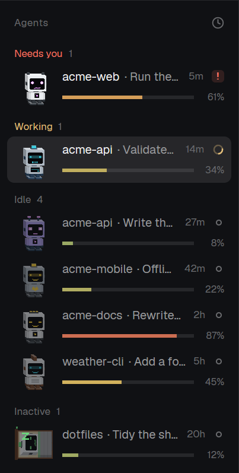

# Agent Cards

The Agents list of the Herdr sidebar, with every agent as a card: a robot of its own, how full its context is, how long it has been in its current state, and what that state is.

## What you get

- **A robot per agent.** The same space and tab always get the same robot, so you learn to find an agent by its face. It bobs while the agent works, shakes in bursts when the agent needs you and dims while it is idle.
- **A context bar.** Green when there is room, through yellow to red as the context fills up, with the percentage next to it.
- **A timer.** How long ago the agent's status last changed: `14m` working, `5m` waiting for you, `2h` idle. It survives a restart of Herdr.
- **Groups by urgency.** Needs you, Working and Idle, as in the shipped list.
- **Sleeping agents.** An agent idle for more than 16 hours moves to a folded Inactive group at the bottom, where its robot lies in bed with Z's rising from its head. Pinned agents and the one you are looking at stay awake.

Sorting, pinning, sub-agents and the narrow rail work as in Herdr's own Agents list.

## Install

Ask your agent in Herdr:

> Read ~/.config/herdr-app/AGENTS.md, then add this mod: https://github.com/Cerbrus/herdr-mods/tree/master/agent-cards
>
> Show it in place of the Agents list.

The agent asks which avatars you want before it installs: see [Pick your own avatars](#pick-your-own-avatars).

Or with PowerShell, from a clone of this repository: `.\Install.ps1 agent-cards`. Add `-Layout` to get the [Borderless Layout](../borderless) with it.

## Pick your own avatars

The robots are [DiceBear](https://www.dicebear.com)'s "Voxel Bot" style, in four body colours. They are one choice out of many: browse the [styles](https://www.dicebear.com/styles/) and tell your agent which one you want when you ask for the mod. Every style has options of its own (colours, hair, eyes, mouth, accessories), which you can try in the [playground](https://www.dicebear.com/playground/).

Styles that also look right lying in the bed of a sleeping agent, because they are a head or a figure seen from the front:

- [Voxel Art](https://www.dicebear.com/styles/voxel-art/)
- [Personas](https://www.dicebear.com/styles/personas/)
- [Pixel Art](https://www.dicebear.com/styles/pixel-art/)
- [Toon Head](https://www.dicebear.com/styles/toon-head/)
- [Avataaars](https://www.dicebear.com/styles/avataaars/)

The bed and the sheet are drawn onto the Voxel Bot picture, so another style needs them fitted again. Your agent does that as part of the change; ask it to show you a sleeping avatar before you settle.

## Keys

| Key | Does |
|---|---|
| `alt-a` | Shows the agent at the top of the list, the one that needs you most |

## Good to know

- **The context bar needs a status line script.** The mod reads `data/claude-statusline/<terminal id>.json` in Herdr's folder (`~/.config/herdr-app`), a file with `{"pct": 34}` in it. Claude Code can write it from its status line; [this script](https://github.com/Cerbrus/utilities/tree/master/claude-statusline) does. Without it the bar stays empty and everything else works.
- **It reaches the network once per robot.** Avatars come from [DiceBear](https://www.dicebear.com) (`api.dicebear.com`). Only a hash of the space and tab name is sent, as the seed. The picture is kept in `data/agent-cards/avatars` and never fetched again.
- **Robots follow names.** Rename a space or tab and its agent gets a new robot. Two agents in one tab share one.
- **The bobbing needs Windows animations.** With "Animation effects" off (Settings > Accessibility > Visual effects) the robots stand still.
- Other mods can read when each agent last changed status: it is `agents.changed` in the shared state. [Timed Tabs](../timed-tabs) uses it.

`RECIPE.md` has the full description for an agent that builds or changes the mod.
