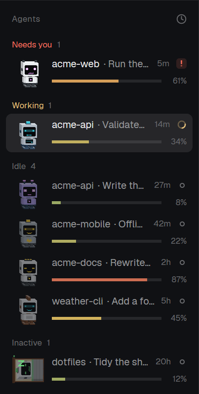

# Agent Cards

The Agents list of the sidebar, with every agent drawn as a card: a pixel robot avatar on the left, and to its right the agent's name, the time since its status last changed, its status and a thin bar showing how full its context is. The robot bobs while the agent works, shakes when it needs you and fades when it is idle. Agents that have been idle for more than 16 hours move to a folded "Inactive" group at the bottom, where their robots lie asleep in a bed with Z's rising from their heads.

**What you see:**

- A 41px header: "Agents" (11.5px, medium, `dim`) on the left and a 14px sort icon on the right. As in the shipped list.
- Group headers, 30px, 11px medium: "Pinned", then the priority sections ("Needs you", "Done", "Working", "Idle") or one per space, then "Inactive". As in the shipped list, plus the Inactive group.
- One card per agent: 52px high, 8px side padding, 8px corners, a 10px gap between avatar and text. The focused agent's card has the `selected` background, a hovered card the `hover` background.
  - Avatar: 44px square, a mirrored voxel robot on a transparent background, the same robot for the same space name and tab name. Until its picture is loaded the square is filled with `raised`.
  - Top line, 18px, 13px type: the name (`foreground`, or `muted` when idle and not focused), then where the shipped list shows it "· detail" in `muted`, a machine name (10px, `dim`) for an agent on another machine, the fold chevron when it has sub-agents, the time since its last status change (11px, `dim`, "<1m", "12m", "3h", "2d"; replaced by the pin button while hovered) and the status mark.
  - Context bar, 6px under the top line: a 4px high track in `border`, filled from the left to the context percentage, and a 28px wide right-aligned label (10.5px, `dim`) such as "37%". The fill runs from `#8ea765` at 0% through `#d9b35c` at 50% to `#c8554f` at 100%, mixed linearly. With no known percentage the track is empty and the label blank.
- Sub-agent rows under a card: 26px, indented 70px so the tree lines start under the text column.
- A sleeping avatar (Inactive group): the same robot turned a quarter turn to lie with its head on the left, on a 128-unit bed (headboard `#5f3820`, frame `#7a4a2d`, mattress `#d8c9a3`, pillow `#f5efe0`), under a sheet in the robot's own body colour darkened by 30%, with a turned-down strip that is the average of that sheet colour and the robot's eye colour. The picture is drawn at 50% opacity. Three Z's in the robot's eye colour (fallback `#69db7c`) rise over it.
- With the sidebar narrower than 160px the list is the shipped rail: 26px rows with a number and a status mark, no avatars and no bars.

**How it behaves:**

- Working: the avatar bobs up and down 1.5px each way, 1100ms per cycle. The status mark is the shipped 12px spinner in `working`.
- Blocked: the avatar shakes sideways in bursts: an outer element swings 1.5px each way at 200ms, the picture inside swings the opposite way at 230ms, so the two cancel and reinforce in turn. The status mark is the shipped "Needs you" pill (or a "!" square under a "Needs you" header).
- Done: the avatar stands still at full opacity. Status mark: the shipped 7px dot.
- Idle: the avatar is at 50% opacity, focused or not. Status mark: the shipped 7px ring.
- Inactive: an agent that is idle, not pinned, not focused, has no sub-agent that is working or blocked, and whose status last changed more than 16 hours ago leaves its group and joins "Inactive", the last group in both sorts. That group starts folded each time the mod loads; its header shows the count. Its rows name their space, as rows do in the Priority sort.
- The Z's: every 900ms the next of the three Z's appears 10px large, 11px right and 11px down from the avatar's top left corner, then over 2600ms drifts to the corner while shrinking to nothing. Each Z restarts every 2700ms. Nothing happens while no sleeping avatar is on screen (the group folded, for instance).
- Click a card: focuses the agent's pane. Click the avatar of an agent with sub-agents: folds or unfolds them. Hover: the time gives way to the pin button.
- `agent-cards.top` (bound to `alt-a` in `keys.json`): focuses the pane of the agent at the top of the list, in the order pinned, the rest, inactive.
- The list redraws every 30 seconds so the times stay current.
- Sorting (Priority, Grouped by space), pinning, group folding, sub-agent trees, peeking at a sub-agent without a pane, the empty-list text and the rail's "»" button behave as the shipped `agents` mod 0.1.16.

**Built from:**

- One mod, `mods/agent-cards/` (`main.js`, `z.svg`, `mod.json`), a clone of the shipped `agents` mod 0.1.16. `mod.json`: `{ "place": "none", "title": "Agents", "cloned_from": { "name": "agents", "version": "0.1.16" } }`. It goes in the layout block where `agents` was: `"content": { "mod": "agent-cards" }`. Start from the shipped `agents/main.js` and add what follows.
- `props`: `sortMenu: true` makes a copy draw the sort popup; the header opens it with `openOverlay({ mod: "agent-cards", kind: "popup", width: 200, height: 140, props: { sortMenu: true } })`.
- Card: the shipped row at `h(52)`, `gap(10)`, with the program icon replaced by the avatar (inside the shipped `agent-fold-<address>` element) and the rest of the row moved into a `v_flex().gap(6)` holding the 18px line and the context bar. Sub rows use `pl(70)` in place of 39.
- Avatar: the key is a 16 hex digit hash of `space_name + "\0" + tab_name`. It is fetched once with `fetch` from `https://api.dicebear.com/10.x/voxel-bot/svg?flip=horizontal&backgroundColor=00000000&bodyColor=e9ecef,aeb8c2,b6a6f5,74c0fc&screenColor=07070a&glowColor=3bc9db,69db7c,ffd43b,e599f7&seed=<key>` and written with `writeTextFile` to `data/agent-cards/avatars/<key>-<style>.svg` under `appHome()`, where `<style>` is the first 6 hex digits of the same hash over the URL. **This reaches the network**: one request per new space and tab name pair, carrying only that hash. Drawn with `image(file).w(44).h(44)`.
- Sleeping avatar: the cached SVG text rewritten and saved beside it as `<key>-<style>-asleep-bed5.svg`. The bed paths go in front of the group `<g transform="translate(128, 0) scale(-1, 1)">`, that group is wrapped in `<g transform="rotate(270, 64, 64)">`, and the sheet paths go before the closing `</svg>`. Body colour: the first of the four `bodyColor` values found as a `fill` in the text. Eye colour: the first `fill` after `id="eyes-`.
- Motion: `.loop("top", { from: -1.5, to: 1.5, period: 1100 })` for working; two nested `.loop("left", ...)` with `easing: "linear"` for blocked. Each Z is four nested elements with their own `id`, one `.transition()` each (`left`, `top`, `width`, `height`), around `svg("mods/agent-cards/z.svg")`; `cx.timer.every(900)` snaps one Z to its start with a 1ms transition and `cx.timer.after(50)` releases it with a 2600ms one.
- Context bar: reads `data/claude-statusline/<terminal id>.json` under `appHome()` with `readTextFile` and uses its `pct` number (`{"pct":37}`), clamped to 0..100. A loop re-reads all agents' files each time `watchFolder` reports a change in that folder. The file is written by a separate Claude Code status line script that is not part of this mod.
- Programs: `exec("cmd", ["/c", "mkdir", ...])` when `appHome()` starts with a drive letter, else `exec("mkdir", ["-p", ...])`, once at start for the two data folders.
- Shared state: reads and writes `agents.sort`, `sidebar.width`, `sidebar.collapsed` as shipped; publishes `agents.changed` (`{ <address>: { s: <status>, at: <ms> } }`, done counted as idle) with `setShared` at start and on every change. `localStorage`: `changed`, `pins`.
- Other `herdr` calls: `agents`, `terminals`, `panes`, `focused`, `spaces`, `layout`, `window`, `theme`, `props`, `setAgentOrder`, `nextCommand`, `closeOverlay`, `checking`; commands `pane.focus`, `terminal.peek`, `terminal.pin`, `layout.resize`.
- Art: `z.svg`, a 5 by 5 pixel "Z" in `currentColor`. From shipped mods: `mods/workspace-chrome/` `spinner.svg`, `clock.svg`, `layers.svg`, `check.svg`, `pin.svg`, `pin-off.svg`, `chevron-down.svg`, `chevron-right.svg`.
- `keys.json`: `{ "global": { "alt-a": "agent-cards.top" } }`.

**Watch out:**

- Guard with `checking()`: during `herdr-app check` the mod must not create folders, fetch or write files.
- `image()` only shows files under the app's folder, not URLs, so the avatar has to be downloaded and cached first. It also caches by path until the app restarts: a rewritten file keeps its old picture. That is why the file name carries a hash of the URL and the sleeping variant has its own suffix; change either when the style or the bed changes.
- `image()` draws an animated SVG as a still. All motion comes from `.loop()` and `.transition()` on elements.
- `.loop()` only swings back and forth, with no delay or phase. The burst shake is two loops with different periods; the one-way Z motion is a transition plus a timer that resets it.
- `.transition()` only animates while the Windows setting "Animation effects" (Settings > Accessibility > Visual effects) is on. With it off each Z only flashes for 50ms and then jumps to size 0.
- Several transitions on one element were never seen working: give each animated property its own nested element with its own `id`.
- The sleeping rewrite depends on the exact text of the fetched SVG (the flip group, the closing `</g></svg>`, `id="eyes-`). If the service changes its output the sleeping file comes out as the upright robot without a bed.
- The avatar follows the space name and tab name: renaming either gives the agent a new robot (one more fetch), and two agents in one tab share a robot.
- The context bar needs the status line script. Without it the bar stays empty. Files are only read for local terminals (ids of letters, digits, `_` and `-`), and only when the folder changes, so a new agent's bar fills at the next write of any file there.
- A failed fetch (offline) leaves the `raised` square and is not retried until the mod reloads.
- The overlay and the art paths name `agent-cards`: rename them together with the folder.
- Cached avatars are never deleted. Entries in `agents.changed` for agents gone more than 30 days are dropped.
- `herdr-app shot` shows animated properties at rest, so the bob, the shake and the Z's need a person to check.

**Done when:**

- `herdr-app check mods/agent-cards` passes and creates nothing under `data/`.
- Each agent shows a 44px robot within a moment of the first draw, and `data/agent-cards/avatars/` holds one SVG per space and tab name pair; a restart draws them without a network request.
- A working agent's robot bobs, a blocked one shakes in bursts, an idle one is dimmed, a done one stands still.
- Writing `{"pct":80}` to `data/claude-statusline/<terminal id>.json` fills that agent's bar to 80% in an orange-red and shows "80%".
- An agent idle for over 16 hours sits in a folded "Inactive" group; unfolded, its robot lies in the bed and Z's rise from it.
- `alt-a` focuses the first agent of the list.
- Another mod reading `shared("agents.changed")` gets an entry per agent.
