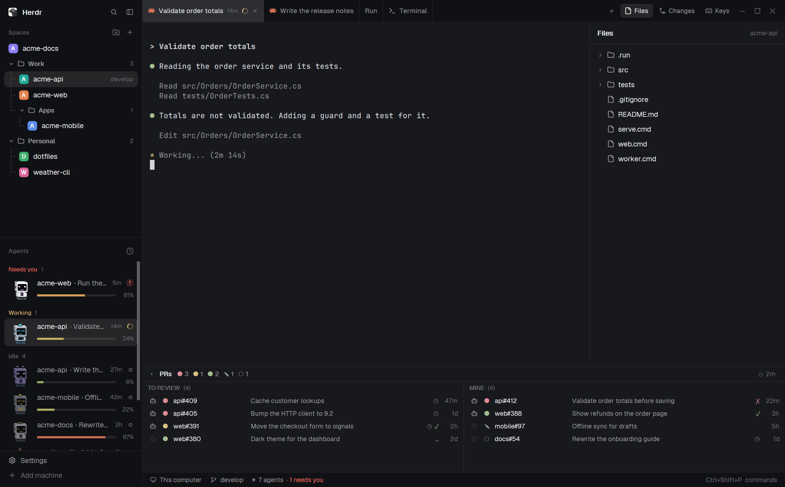
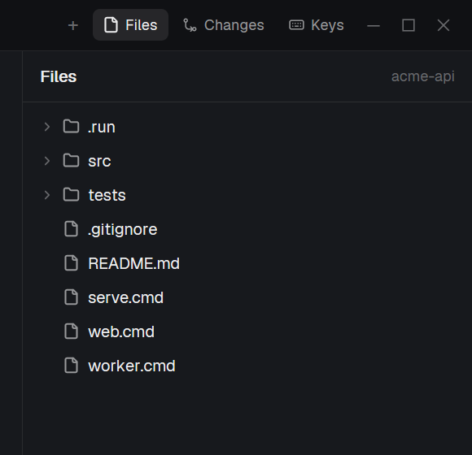
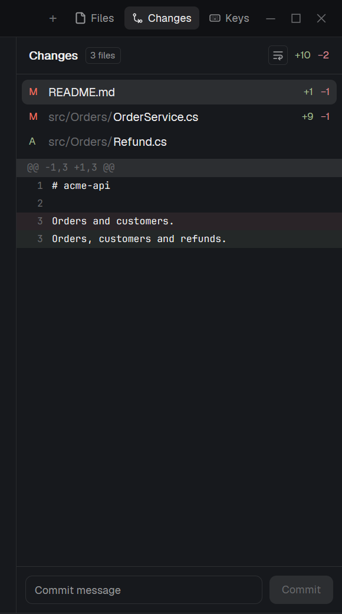

# Borderless Layout

Herdr's main layout with everything flush: square panes and panels that sit against each other with a single line between them, instead of rounded cards with space around them. More room for terminals, less for decoration.



## What you get

- **Flush panes.** Terminals, the side panel and the bars meet in 1px lines. No rounded corners, no gaps.
- **A tab with one pane is only the terminal**: no header, no frame. Split it and each pane gets a header.
- **A flat tab bar.** Tabs fill the bar and are divided by lines.
- **Files and Changes without their rounded border**, so they sit flush as well.

  

- **Changes can wrap long lines.** A Wrap button in its header folds long diff lines instead of scrolling sideways.

  

- **Room for the other mods of this repository.** Each shows up in its place once it is installed. Without it, Herdr's own version shows, or the place stays empty:

  | Place | With the mod | Without |
  |---|---|---|
  | Spaces list | [Space Folders](../space-folders) | Herdr's Spaces list |
  | Agents list | [Agent Cards](../agent-cards) | Herdr's Agents list |
  | Tab bar | [Timed Tabs](../timed-tabs) | The flat tab bar that comes with the layout |
  | Side panel, third page | [Shortcuts](../shortcuts) | Left out |
  | Bar under the terminals | [PR Inbox](../pr-inbox) | Left out |

The picture at the top shows the layout with all of them.

## What is in it

One layout and three mods of its own. All four are clones of what Herdr ships, changed only in how they look (and the Wrap button):

| Part | Clone of |
|---|---|
| `layouts/borderless.json` | the `main` layout |
| `borderless-tabs` | the `tabs` bar |
| `borderless-files` | the `files` panel |
| `borderless-changes` | the `changes` panel |

## Install

Ask your agent in Herdr:

```text
Read ~/.config/herdr-app/AGENTS.md, then add this layout: https://github.com/Cerbrus/herdr-mods/tree/master/borderless
```

To get more of what is in the picture, have the agent go through the repository with you:

```text
Read ~/.config/herdr-app/AGENTS.md, then add this layout: https://github.com/Cerbrus/herdr-mods/tree/master
```

Or with PowerShell, from a clone of this repository: `.\Install.ps1 borderless` for the layout alone, `.\Install.ps1` for everything, without asking.

## Using it

Switch to it with `ctrl-shift-l`, which goes through your layouts, or pick it in Settings. Your own layout stays as it was; the same key switches back.

## Good to know

- **Herdr never updates a clone.** When a Herdr update changes its own layout, tab bar or panels, this repository merges that in (`Merge-Upstream.ps1`); pull it and install again.
- The colours, fonts and theme are yours: the layout sets none, so Settings decides them.
- The Wrap button in Changes estimates how many characters fit on a line. With an unusual font a wrapped line can break a little early or late.

`RECIPE.md` has the full description for an agent that builds or changes the layout and its mods.
