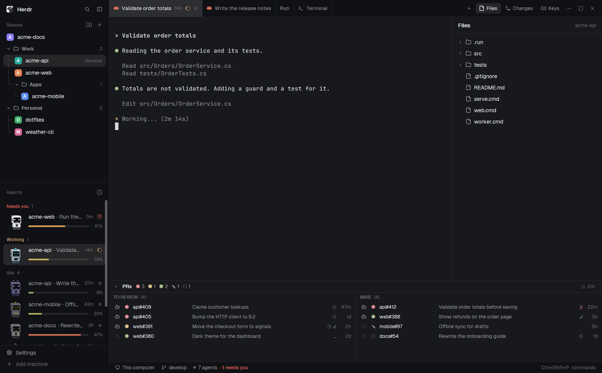

# Borderless Layout

Herdr's `main` layout with everything flush: square panes and panels separated by 1px lines instead of rounded cards with 8px between them. A tab with one pane is only the terminal, without a header or frame. The sidebar shows spaces in folders and agents as cards, the tab bar times working agents, the side panel has two more pages, a git graph and the keyboard shortcuts, and a bar with your pull requests sits between the terminals and the status bar.



## What you see

Left to right, on the `canvas` background, with a 1px `border`-coloured divider between sidebar and work area and no system title bar:

- **Sidebar**, 268px wide (44 to 480), `chrome` background. Top to bottom:
  - the brand row, 46px; dragging it moves the window;
  - the spaces list and the agents list, sharing the height equally (weight 1 each, at least 90px each);
  - the footer, 69px.
- **Work area**, the rest of the width. Top to bottom:
  - the tab bar, 42px; dragging it moves the window;
  - the terminals of the active tab, and to their right the side panel, 368px wide (280 to 900), hidden until you open it. One 1px line separates them;
  - the pull requests bar, 29px when folded;
  - the status bar, 28px.

The terminals: panes are square, 1px apart, with the line between them in the `border` colour. Each pane of a split tab has a 30px header on top. The focused pane has a 1px `accent` ring; the others have a 1px edge in the `background` colour, so nothing shifts when focus moves. Terminal text is padded 14px left and right and 12px top and bottom.

The side panel has four pages, one shown at a time: Files, Changes, Git and Keys. None has a border or rounded corners of its own.

## How it behaves

The layout itself has no behaviour; its mods do. Agent statuses (working, blocked, done, idle) are drawn by the agents list, the tab bar and the spaces list; see the recipes of `agent-cards`, `timed-tabs` and `space-folders`.

- `Files`, `Changes`, `Git` and `Keys` in the tab bar open the side panel on that page; the button of the open page closes it. The panel's left edge can be dragged between 280px and 900px.
- A tab with a single pane shows no header, border or focus ring. Split it and every pane gets its header.
- The pull requests bar folds and unfolds by changing its own height; its top edge can be dragged.
- The sidebar and the work column have fixed sizes among their siblings (`resizable: false`), as in the shipped layout.

## Built from

`layouts/borderless.json`, a clone of the shipped `main` layout (0.1.16, recorded in `cloned_from`).

Root look: `"background": "canvas"`, `"terminal_padding": [14, 12]`, `"divider": { "width": 1, "color": "border" }`, `"titlebar": "none"`, `"traffic_lights": [12, 16]`.

Node tree (`id`: type, size, content):

```
root: row
  sidebar: column, 268px, min 44, max 480, background chrome, resizable false
    brand: block, 46px, window_drag, mod workspace-chrome
    sidebar-lists: column
      spaces: block, weight 1, min 90, mod space-folders
      agents: block, weight 1, min 90, mod agent-cards
    sidebar-footer: block, 69px, mod workspace-chrome, props { footer: true }
  work: column, resizable false
    tabs: block, 42px, window_drag, mod timed-tabs
    work-main: column
      work-body: row, padding 0, gap 1, background border
        main: block, tab active (pane frame below)
        panel: column, 368px, min 280, max 900, hidden
          panel-body: stack, active files
            files: block, mod borderless-files
            changes: block, mod borderless-changes
            graph: block, mod git-graph
            shortcuts: block, mod shortcuts
      prs: block, 29px, min 29, mod pr-inbox
    status: block, 28px, mod workspace-status
```

Pane frame of `main`: `"header": { "content": { "mod": "pane" }, "reveal": "always", "height": 30, "position": "top" }`, `"background": "background"`, `"border": { "width": 1, "color": "background" }`, `"focus": { "width": 1, "color": "accent" }`, `"radius": 0`, `"gap": 1`, `"lone": false`.

What differs from the shipped `main`:

- Mods swapped: `spaces` to `space-folders`, `agents` to `agent-cards`, `tabs` to `timed-tabs`, `files` to `borderless-files`, `changes` to `borderless-changes`.
- `work-body`: `padding` 8 to 0, `gap` 8 to 1, and a `background` of `border`.
- Pane frame: `gap` 8 to 1, `radius` 10 to 0, border colour `border` to `background`, `lone` true to false.
- `panel-body` has two more children, `graph` and `shortcuts`.
- `work-main` is new: a column around `work-body` and the new `prs` block.

Mods that come with the layout, in this folder's `mods/` (described at the end of this recipe): `borderless-files`, `borderless-changes` and `borderless-tabs`. Mods it shows when they are installed, each a sibling folder of this repo with its own recipe: `space-folders`, `agent-cards`, `timed-tabs`, `shortcuts`, `pr-inbox`. One mod from another repository, shown when it is installed: `git-graph` (https://github.com/rabeeh-ta/herdr-git-graph). Shipped mods used as they are: `workspace-chrome` (twice, the footer with `props.footer`), `pane`, `workspace-status`. The layout passes no other `props`, runs no programs and has no art.

Fitting it to what is installed: the repo's `Install.ps1 -Layout` writes the layout so that a block whose mod is not installed shows what stands in for it (`spaces` for `space-folders`, `agents` for `agent-cards`, `borderless-tabs` for `timed-tabs`), and leaves the `graph`, `shortcuts` and `prs` blocks out when those mods are missing, as they have no shipped original. An agent adding the layout by hand does the same.

## Watch out

- A negative `gap` is ignored, and two touching 1px borders make a 2px seam. The 1px lines come from a `gap` of 1 over a `border`-coloured `work-body` background, with no visible border on panes or panels. That only works with panels that draw no border themselves: `borderless-files` and `borderless-changes`, not the shipped `files` and `changes`, which keep their rounded border.
- A pane's `focus` ring takes space. Without a `border` of the same width the terminal resizes each time focus moves; hence the 1px border in the `background` colour.
- `lone: false` drops the whole frame of a tab's only pane, header included, not only the border and the ring. The header's buttons (split, zoom, close) are then only reachable by key or menu.
- `work` is `resizable: false`, so nothing directly inside it can be dragged. `work-main` exists only so the edge between the terminals and `prs` can be.
- `pr-inbox` folds by resizing the block with id `prs`, so that block needs a pixel size and `"min": 29`. Rename the block and the mod needs `props.block`.
- The tab bar's `Files` and `Changes` buttons select the stack children by the ids `files` and `changes`, and `timed-tabs` shows `Git` and `Keys` only when `panel-body` has a child with id `graph` and `shortcuts`. Keep the ids `panel`, `panel-body`, `files`, `changes`, `graph`, `shortcuts`.
- Leaving the `shortcuts` or `graph` block in without its mod gives a `Keys` or `Git` button that opens an empty page; leave the block out instead.
- `space-folders` needs the `project-picker` mod, and the timer in `timed-tabs` reads `agents.changed`, which `agent-cards` writes: with the shipped `agents` list the timer starts counting when the tab bar first sees the agent working.
- It is a clone: Herdr never updates it. After an app update, merge what changed in the shipped `main` layout.
- `traffic_lights` only matters on macOS.

## Done when

- `layout.switch { name: "borderless" }` shows the layout without a warning about an unknown mod.
- A tab with one terminal shows the terminal only: no header, no rounded corners, no gap around it.
- After a split, each pane has a 30px header, the panes are 1px apart, and moving focus between them does not change the size of either terminal.
- `Files`, `Changes`, `Git` and `Keys` in the tab bar each open the side panel on their page, with one 1px line between the terminals and the panel.
- The pull requests bar is 29px high under the terminals and unfolds on a click.
- `ctrl-shift-l` switches back to the previous layout, which is unchanged.

## The mods that come with it

The layout is one item with three mods of its own, so it draws flush without anything else installed. Each is a clone of a shipped mod; add all three with the layout.

### borderless-tabs

A clone of the shipped `tabs` bar (0.1.16) with only its look changed, for the 42px `tabs` block of this layout: tabs fill the height of the bar (`h_full()` where the shipped one is 29px high with `rounded(7)`), sit against each other with no gap, and are divided by a 1px right border in `border` (the first tab also gets a left border on macOS when the traffic lights push the bar in). The fallback left padding is 0 where the shipped bar has 10. The window button icons are its own copies (`mods/borderless-tabs/win-*.svg`). Everything else is the shipped bar. When the `timed-tabs` mod is installed the layout shows that instead: it has the same look, with a timer per working tab.

### borderless-files

The Files side panel of Herdr without its rounded card: no 10px corners and no 1px border around it, so it sits flush against whatever the layout puts next to it. Everything else is the shipped `files` panel: a file tree of the focused pane's folder with git marks and a read-only preview.

#### What you see

A panel that fills its block, 13px text on the `background` colour, square, with no border of its own.

- **Header**, 42px, 1px `border` line below: `Files` in semibold on the left; on the right, in 12px `dim`, the name of the folder shown, or the path of the file being previewed. While a file is previewed a `←` sits in front of the title.
- **Tree**, scrolling, 6px padding: 28px rows with 7px rounded corners. A folder row has a 12px chevron (right when folded, down when open) and a 14px folder icon; a file row has a 14px file icon. Each level is indented 18px. A changed file has a mark at the end in 11px: `A` in `ansi2`, `D` and `U` in `ansi1`, `M` in the `blocked` colour.
- **Preview**, in place of the tree: a read-only code editor at 12px in the terminal font with syntax colours from the theme.
- Messages in `dim`: "Loading files…", "No files", "No folder", an error text, or "File list limited to 500 entries per folder and 5,000 total".

#### How it behaves

As the shipped `files` mod:

- It follows the focused pane: its folder, else the space's folder. Switching pane or space switches the tree, and coming back restores the open folders and the previewed file.
- Click a folder to open or fold it; folding forgets what was open inside it. Click a file to preview it; `←` returns to the tree.
- Rows show the `hover` background under the pointer.
- The tree refreshes when the folder changes on disk and every 10 seconds.
- `.git` is never listed. Folders come first, then files, by name.
- A file with a null byte shows "Binary file · no text preview"; a preview is cut at 400,000 characters.
- It draws no agent status.

#### Built from

One mod, `borderless-files`, a clone of the shipped `files` mod (0.1.16; `mod.json` has `"place": "none"` and `cloned_from`). It takes no `props`. Put it in a layout block: `"content": { "mod": "borderless-files" }`.

The whole difference from the shipped mod:

- The root element has no `.rounded(10)` and no `.border_1().border_color(t.border)`. It keeps `.overflow_hidden()` and the `background` colour.
- The icons are read from the clone's own folder: `mods/borderless-files/chevron-right.svg`, `chevron-down.svg`, `folder.svg`, `file.svg` (copies of the shipped ones).

Unchanged from the shipped mod:

- `herdr` functions: `spaces`, `panes`, `focused`, `exec`, `readTextFile`, `watchFolder`, `theme`, `settings`, `window`. UI: `Editor`, `EditorState` from `gpui-base`.
- Programs it runs: `powershell -NoProfile -Command` with `Get-ChildItem` to list a folder on Windows, `sh -c` elsewhere and on remote machines; `git rev-parse --show-toplevel` and `git --no-optional-locks -c core.fsmonitor=false status --porcelain=v1 -z --no-renames --untracked-files=all` for the marks.
- A 10,000 ms timer plus `watchFolder` on the folder (local folders only).
- It runs no commands.

#### Watch out

- It runs `powershell` or `sh`, and `git`, and reads files outside its own folder (that is its job). Tell the person before adding it.
- A panel without a border needs a layout that draws the lines. With a `gap` of 1 between blocks over a `border`-coloured background the panel gets 1px seams; in a layout with padding around its panels it looks like a bare rectangle.
- Do not edit the shipped `files` mod: Herdr updates overwrite it. Clone it (`mod.clone { name: "files", as: "borderless-files" }`), which rewrites the `mods/files/` asset paths, then remove the two calls.
- Herdr never updates a clone. After an app update, compare the shipped `files` mod with this one and merge what changed.
- The tab bar's Files button points at the layout block with id `files`, not at the mod name. Keep that block id when swapping the mod in.
- Limits: 500 entries per folder, 5,000 in total, 40 levels deep.

#### Done when

- `herdr-app check` passes on `borderless-files`.
- In a layout block the panel has square corners and no line of its own around it.
- The folder and file icons show (they load from `mods/borderless-files/`).
- Clicking a folder opens it, clicking a file shows its preview and `←` returns to the tree.
- A file changed in a git repository gets an `M` at the end of its row within 10 seconds.

### borderless-changes

The Changes side panel of Herdr without its rounded card, with a button that wraps long diff lines and a sideways scrollbar that is always there. Everything else is the shipped `changes` panel: the uncommitted files of the focused pane's repository, the diff of one of them, and a commit field.

#### What you see

A panel that fills its block, 13px text on the `background` colour, square, with no border of its own. Top to bottom:

- **Header**, 42px, 1px `border` line below: `Changes` in semibold, a small bordered count (`3 files`, 10px, `muted`), then on the right the **wrap button** and the totals `+12` in `ansi2` and `−4` in `ansi1` (11px).
  - The wrap button is a 22px square with 4px corners and a 1px border holding a 13px wrap icon. Off: `border`-coloured border, `muted` icon. On: both in `accent`.
- **File list**, 28px rows, at most as tall as its rows and at least 44px, 1px line below: the status letter (`A` in `ansi2`, `D` and `U` in `ansi1`, `M` in the `blocked` colour), the folder part of the path in `dim`, the file name, and that file's `+` and `−` counts. The open file has the `selected` background.
- **Diff**, terminal font (`settings().font_family`, else JetBrains Mono) at 11px, 20px rows: a 30px right-aligned line number in `dim`, then the text. Added rows have an `ansi2` tint, removed rows an `ansi1` tint (the colour plus `18` alpha). Hunk headers (`@@ ... @@`) are `dim` on `raised`. A horizontal scrollbar is always shown under the diff, and a vertical one over it.
- **Commit bar**, 1px line above, 10px padding: a 32px field with the placeholder "Commit message" (border turns `accent` while you type) and a `Commit` button, `solid` when it can be used.
- Messages in `dim`: "Loading changes…", "No uncommitted changes", "No folder", "Not a git repository", "Select a file to view its changes", "Showing the first 1,000 changed files". A failed commit shows its error in `ansi1` above the commit bar.

#### How it behaves

Added by this clone:

- **Wrap button**: click to switch between wrapping and sideways scrolling. The tooltip reads "Wrap long lines" when off and "Long lines wrap. Click to scroll sideways instead" when on. The choice is remembered.
- With wrap on, a line longer than the panel is split into extra rows. A split falls after the last space in the line's second half, else in the middle of a word. Only the first row of a line has its line number; the others keep the tint. Hunk headers are never split. Resizing the panel wraps again.
- With wrap off, the diff is as wide as its longest line and scrolls sideways, as shipped.

As the shipped `changes` mod:

- It follows the focused pane's folder (else the space's) and shows that repository's changes against `HEAD`, untracked files included.
- The first file's diff shows until you pick another. Click a file to show its diff; click the open file to close it.
- Enter in the field or a click on `Commit` stages everything and commits it with the message. Escape leaves the field.
- It refreshes when the repository changes on disk and every 10 seconds.
- Rows show the `hover` background under the pointer. It draws no agent status.

#### Built from

One mod, `borderless-changes`, a clone of the shipped `changes` mod (0.1.16; `mod.json` has `"place": "none"` and `cloned_from`). It takes no `props`. Put it in a layout block: `"content": { "mod": "borderless-changes" }`.

The whole difference from the shipped mod:

- The root element has no `.rounded(10)` and no `.border_1().border_color(t.border)`.
- `svg` is imported from `gpui-kit` and `text-wrap.svg` is added (a 24 by 24 line icon, stroke `currentColor`, read from `mods/borderless-changes/text-wrap.svg`).
- `this.wrap` starts from `localStorage.getItem("wrap") === "1"`; `toggleWrap` flips it and stores `"1"` or `"0"`.
- The header gets the button `changes-wrap` between the spacer and the totals. Its `on_mouse_down("left")` stops propagation.
- The horizontal scroll container `changes-diff-x` gets `.mode("always")` and an `on_size_change` that keeps its size in `this.diffSize` and redraws when wrap is on.
- `shownRows()` returns the rows to draw. With wrap on it computes `columns = max(20, floor((width - 60) / 6.7))` (60px for the number gutter, 6.7px per character) and calls `wrapRows`, which splits each row whose text is longer into rows of at most `columns` characters. The result is cached per row set and column count.
- The virtual list (`v_virtual_list("changes-diff", rows.length, 20, ...)`) draws those rows, and the inner element's `min_w` is 0 with wrap on instead of the diff's width.

Unchanged from the shipped mod:

- `herdr` functions: `spaces`, `panes`, `focused`, `exec`, `readTextFile`, `watchFolder`, `theme`, `settings`. UI: `InputState`, `Input`, `Scrollbar`, `v_virtual_list`.
- Programs it runs: `git` only. Reads with `--no-optional-locks -c core.fsmonitor=false -c diff.autoRefreshIndex=false`: `rev-parse --show-toplevel`, `status --porcelain=v1 -z --no-renames --untracked-files=all`, `rev-parse --verify HEAD`, `diff HEAD --numstat -z --no-renames`, `diff HEAD --no-ext-diff --no-textconv --no-color -- <path>`. Writes: `git add -A`, then `git commit -m <message>`.
- It runs no commands.

#### Watch out

- It runs `git`, and `Commit` stages every change in the repository (`git add -A`) before committing. It reads files outside its own folder. Tell the person before adding it.
- The diff is a virtual list with a fixed row height of 20px, so a row cannot grow. Wrapping therefore makes more rows, it does not let text flow.
- The width per character is an estimate (6.7px at 11px). With another font or size a row can still be a little too long; each row is truncated, so the overshoot is cut off, not drawn over its neighbour.
- Wrapping only starts after the diff area has reported its size once.
- A tab is drawn as nothing by text elements; the shipped code pads each to the next 4-column stop. Keep that, the wrap counts those characters.
- A panel without a border needs a layout that draws the lines: a `gap` of 1 between blocks over a `border`-coloured background.
- Do not edit the shipped `changes` mod; clone it (`mod.clone { name: "changes", as: "borderless-changes" }`) and change the clone. Herdr never updates a clone, so merge shipped changes in after an app update.
- The tab bar's Changes button points at the layout block with id `changes`. Keep that block id.
- Limits: 1,000 files, 1,500 diff lines per file, 4,000 characters per line, 400,000 characters of a new file.

#### Done when

- `herdr-app check` passes on `borderless-changes`.
- In a layout block the panel has square corners and no line of its own around it.
- In a repository with a changed file, the file is listed and its diff shows without a click.
- With a diff line wider than the panel: the horizontal scrollbar is visible; a click on the wrap button turns it `accent` and the line continues on the next rows, with one line number.
- Making the panel narrower with wrap on splits the line into more rows.
- The wrap choice is still set after the app restarts.
- Typing a message and pressing Enter commits, and the list empties.
