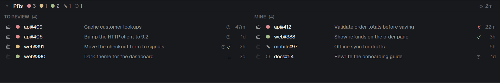
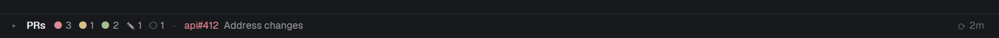

# PR Inbox

Your open pull requests in a bar under the terminals: what waits for your review, what happened to your own, and one click to put an agent on it.



Folded, it is one line: the counts, and the pull request that needs you most.



## What you get

- **Two lists.** To review: pull requests that ask for your review or that you reviewed before. Mine: the ones you wrote.
- **A flag that says whose turn it is.**

  | Flag | Means |
  |---|---|
  | Red | Needs you: review it, resolve conflicts, or address requested changes |
  | Yellow | Worth a look: comments to answer, no reviewers yet, or someone else already reviewed it |
  | Green | Good: approved and ready to merge, or you reviewed it and it is the author's turn |
  | Pencil | A draft of yours |
  | Open circle | Waiting on others |

- **Reviewers at a glance.** A mark per reviewer at the end of the row: requested, approved, changes requested or commented. Hover for their names.
- **An agent per pull request.** The icon in front of a row that needs something goes to the space of that repository (or opens it), starts a new agent tab and sends it the task: `When I say go, review #409`, and likewise `handle feedback on #412` or `merge #388`. The agent waits for your go.
- **A click on the row** opens the pull request in the browser.
- It refreshes every five minutes; the arrow at the right refreshes now and shows how old the list is.

## Install

Ask your agent in Herdr:

```text
Read ~/.config/herdr-app/AGENTS.md, then add this mod: https://github.com/Cerbrus/herdr-mods/tree/master/pr-inbox
```

Or with PowerShell, from a clone of this repository: `.\Install.ps1 pr-inbox -Layout`, which also installs the [Borderless Layout](../borderless) that has the bar in place.

It needs the [GitHub CLI](https://cli.github.com), logged in (`gh auth login`).

## Setting it up

`mods/pr-inbox/config.js`:

```js
export const OWNER = "acme";
export const REPOS = /^acme-/;
export const ROOTS = ["C:\\DEV"];
export const ARGV = ["claude"];
```

| Setting | What it does | Left empty |
|---|---|---|
| `OWNER` | The GitHub organisation whose pull requests are listed | Every open pull request you wrote or are asked to review |
| `REPOS` | Which repositories count, by name. What matches is cut from the row: `acme-api#412` shows as `api#412` | All of them, with their full name |
| `ROOTS` | Where the folder of a repository is looked for when its space is not open yet | The agent icon only works for repositories that already have a space |
| `ARGV` | What the agent icon starts | `claude` |

The file is yours: an update never overwrites it. Saving it applies at once.

## Using it

Click the bar to unfold it and again to fold it. Drag its top edge to make it taller; the height is remembered.

The agent icon looks for a space named after the repository, or one with a terminal in a folder of that name. If there is none, it opens the folder `<root>\<repository>` as a new space.

## Good to know

- **It reaches GitHub through `gh`**, with your login: one search every five minutes. Nothing else leaves your computer.
- The task is sent as the agent's first message and starts with "When I say go,", so the agent holds until you say go and you can add to the task first.
- Finding a repository's folder uses `cmd`, so opening a space that is not open yet is Windows only. The lists work everywhere.
- A pull request with the label `ship` counts as waiting to be merged. Reviews by Copilot are ignored.
- It expects a block of its own in the layout with a height in pixels: it folds by resizing that block.

`RECIPE.md` has the full description for an agent that builds or changes the mod.
