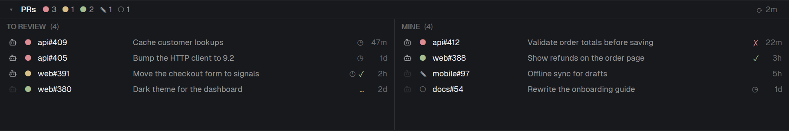

# PR Inbox

A bar under the terminals with your open GitHub pull requests. Folded, it is one line: how many need you, how many wait on others, and the most urgent one. Unfolded, it shows two lists side by side, the pull requests you are asked to review and your own, each with a coloured flag, the reviewers' verdicts and its age. An icon in front of a row starts an agent in that repository's space with the task typed in.

## What you see

12px text on the `background` colour. Top to bottom:

- A 1px line in the `border` colour.
- **Bar**, 28px: `▸` (folded) or `▾`, `PRs` in semibold, then a count per flag that occurs, in this order: `●` in `ansi1`, `●` in `ansi3`, `●` in `ansi2`, `✎` in `muted`, `○` in `dim`, each followed by its number in `muted`. Folded, a `·` and the most urgent pull request follow: its label (`web#412`) in its flag colour and what to do (`Review needed`) in `muted`. On the right a refresh button: `⟳` and the age of the data (`3m`), a braille spinner while loading, `failed` after an error. Before the first answer the bar says `Loading`; with nothing open `No open pull requests`; an error shows its first line in `ansi1`.
- Unfolded: another 1px line, then two columns of equal width with a 1px line between them, **TO REVIEW** on the left and **MINE** on the right. Each has a 24px heading (11px, semibold, `dim`, with the count in brackets) and scrolls on its own. An empty column says `Nothing here`.
- **Row**, 24px: a 20px agent icon, the flag glyph, the label in a 138px column, the title in `muted` (truncated), one glyph per reviewer, and the time since the last update right-aligned in `dim` (`12m`, `5h`, `3d`).
  - Reviewer glyphs: `◷` requested (`dim`), `✓` approved (`ansi2`), `✗` changes requested (`ansi1`), `…` commented (`ansi3`).
  - The agent icon is `muted` when the row has a task and `border`-coloured when it has none.

Flags: red (`ansi1`) needs your action, yellow (`ansi3`) needs attention, green (`ansi2`) is ready or done by you, `✎` is a draft, `○` waits on others. Each list is sorted by flag in that order, then newest update first.

## How it behaves

It draws no agent status. Its own states are the flags, set by these rules, first match wins.

Your own pull requests:

| When | Flag | Text | Agent task |
|---|---|---|---|
| GitHub reports conflicts | red | Resolve conflicts | `Handle feedback on #N` |
| Review decision is changes requested, and a latest review says so | red | Address changes | `Handle feedback on #N` |
| Review decision is approved | green | Merge it | `Merge #N` |
| It is a draft | draft | Draft, mark ready | none |
| It has the label `ship` | waiting | Ship, awaiting merge | none |
| No reviewer requested and no review yet | yellow | Add reviewers | none |
| A latest review is a comment | yellow | Address comments | `Handle feedback on #N` |
| Otherwise | waiting | Waiting on review | none |

Pull requests of others that request your review or that you reviewed:

| When | Flag | Text | Agent task |
|---|---|---|---|
| You reviewed and are not requested again | green | Done, author's turn | none |
| Someone else approved or requested changes, and your own last review is not "changes requested" | yellow | Reviewed by Ann, Bo | `Review #N` |
| Otherwise | red | Review needed | `Review #N` |

For a pull request whose author's login starts with `dependabot`, the review task is `Review #N, and fix any issues. Work towards finalizing this PR so it can be merged.` Reviews and requests by logins containing `copilot`, and team review requests, are left out everywhere.

- **Click the bar**: fold or unfold. Unfolding returns to the height it had; the first time the height fits the longer list, up to 8 rows. Drag the block's top edge to resize it.
- **Click the folded bar's pull request**, or **a row**: open it in the browser.
- **Click the refresh button**: fetch now. It also fetches every five minutes; ages redraw every minute.
- **Click a row's agent icon** (only when it has a task): go to the repository's space, open a new tab there running the agent, wait until that agent is idle and paste the task into it. The task is not sent; you press Enter. If no space is open for the repository, its folder is looked up and opened as a new space running the agent.
- **Hover**: rows and the bar get the `hover` background; the agent icon turns `accent` on `raised`. Tooltips: the counts explain each flag, a row gives its text, `repository#number` and each reviewer's first name with their verdict, the agent icon says `New agent tab: <task>`, the refresh button shows the error if there is one.

## Built from

One mod, `pr-inbox`: `main.js`, `config.js`, `mod.json` (`{ "place": "none", "title": "Pull requests" }`). No shipped mods are used; the agent icon is Herdr's `icons/agent.svg`.

`config.js` is the person's own file and exports four values:

- `OWNER`: a GitHub organisation or user, such as `"acme"`. Adds `org:acme` to the searches. Empty: every open pull request you wrote or are asked to review.
- `REPOS`: a regex on repository names, such as `/^acme-/`, or `null` for all. What it matches is also cut from the label, so `acme-web#412` shows as `web#412`.
- `ROOTS`: folders in which `<root>\<repository name>` is looked for when no space is open, such as `["C:\\src"]`.
- `ARGV`: what the agent icon starts, `["claude"]` by default.

The layout: a block between the terminals and the status bar, `{ "id": "prs", "type": "block", "content": { "mod": "pr-inbox" }, "size": { "px": 29 }, "min": 29 }`. `props`: `block`, the id of that block when it is not `prs`.

- Data: one `exec("gh", ["api", "graphql", ...], { timeout: 60000 })` with three searches of 50 results each: `is:pr is:open author:@me`, `review-requested:@me` and `reviewed-by:@me`. Per pull request it asks for `url number title isDraft updatedAt mergeable reviewDecision`, the repository name, author, labels, review requests, latest reviews and the last 100 reviews. The rules are the functions `authoredAction` and `reviewAction`.
- Timer: `cx.timer.every(60000)`, which refreshes when the last fetch started five minutes ago or more.
- Folding: `layout()` to read the block's `size.px` (folded means 29 or less), `run("layout.resize", { id, px })` to set it. The open height is `localStorage` key `height`; the first open is `1 + 28 + 1 + 24 + rows * 24 + 8`.
- Opening a link: `cx.open_url(url)`.
- Starting a task: find a local space named as the repository, or one with a pane whose folder has that name (`spaces()`, `panes()`). Found: `space.select { id }`, `tab.new { space, argv: ARGV }`. Not found: `exec("cmd", ["/c", "dir", "/b", "/ad", folder])` per root, then `space.new { folder, argv: ARGV }`. Poll `agents()` every 500 ms for at most 90 seconds for a new agent in that space with status `idle`. Then `space.select`, `tab.select { id }`, `pane.focus { terminal }`, `cx.write_to_clipboard(text)`, `terminal.paste` after 200 ms, and the old clipboard text back after 1500 ms.
- Other `herdr` functions: `theme`, `props`, `checking`, `notify`. UI: `Scrollbar.vertical`, `.frames()` for the spinner.

## Watch out

- It runs `gh` and reaches GitHub through it, with the account `gh` is logged in to, every five minutes. It also runs `cmd`. Tell the person before adding it. Without an authenticated GitHub CLI the bar shows the error.
- Keep an existing `config.js`. Adding or updating the mod must not overwrite it; only copy it when there is none.
- `hc keys` cannot type capitals or `#`, and `hc send` always presses Enter. That is why the task goes through the clipboard and `terminal.paste`. A clipboard that held something other than text is not put back.
- The block must have a pixel height. The mod stores no folded flag: the block's height is the state, so a block with a `weight` never unfolds properly. Give it `"min": 29` so it cannot be dragged smaller than the bar.
- For the block's top edge to be draggable its parent column must be resizable. In a layout whose work column is `"resizable": false`, wrap the terminals and this block in a column of their own.
- Finding a folder uses `cmd /c dir` and backslashes: Windows only. On another system the icon works only for repositories that already have a space.
- Spaces on other machines are skipped, and a space matches by name, so the space should be named after the repository folder.
- The agent icon always opens a new tab, even when an agent is already running there. One task waits at a time: a second click replaces the first.
- 50 pull requests per search; more are not shown. The label column is 138px, longer labels are cut.
- `ship` is a label convention (waiting for a merge without review). Without such a label that rule never fires.
- "Add reviewers" has no agent task, and neither have drafts: those rows' icons do nothing.
- Start nothing while `checking()` is true, or `herdr-app check` calls `gh`.

## Done when

- `herdr-app check` passes on `pr-inbox`.
- The block shows a 28px bar with `PRs`, the counts and the age of the data; a click unfolds it to `TO REVIEW` and `MINE`, another click folds it to 29px.
- After dragging it taller, folding and unfolding returns to that height.
- With `OWNER = "acme"`, only pull requests of that organisation are listed; with `REPOS = /^acme-/` a row of `acme-web` is labelled `web#<number>`.
- A pull request of yours with conflicts is red and reads `Resolve conflicts` in its tooltip.
- A click on a row opens the pull request in the browser.
- A click on the agent icon of a `Review needed` row selects the repository's space, opens a tab running `ARGV`, and `Review #<number>` appears at the agent's prompt, not yet sent.
- With `gh` logged out, the bar shows the error in red and `failed` next to the refresh button.
