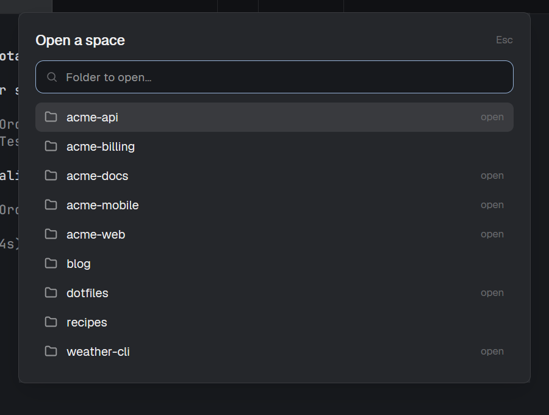

# Project Picker

Press a key, type a few letters, press Enter: the project opens as a new Herdr space with your agent already running in it.



## What you get

- **A list of your project folders**, narrowed as you type. Names that start with what you typed come first.
- **Enter opens it** as a space named after the folder, running `claude` (or whatever you set). Up and down move through the list, Esc closes it.
- **No doubles.** A project that is already open says `open`, and Enter takes you to that space instead of making a second one.
- **Any folder.** Type a full path (`C:\somewhere\else`) and it is offered as it is.
- With [Space Folders](../space-folders): opened from a folder's menu, the new space lands in that folder.

## Install

Ask your agent in Herdr:

```text
Read ~/.config/herdr-app/AGENTS.md, then add this mod: https://github.com/Cerbrus/herdr-mods/tree/master/project-picker

Bind ctrl-shift-n to it, and ask me where my projects are for its config.js.
```

Or with PowerShell, from a clone of this repository: `.\Install.ps1 project-picker -Rebind`.

## Keys

| Key | Does |
|---|---|
| `ctrl-shift-n` | Opens the picker |

Herdr binds `ctrl-shift-n` to "New space", which asks for nothing and starts a shell. The picker takes its place; "New space" stays in the `+` menu and the command palette. `Install.ps1` only takes the key with `-Rebind`.

## Setting it up

Say where your projects are in `mods/project-picker/config.js`. Every folder directly under a root is listed:

```js
export const ROOTS = [
  { path: "C:\\DEV" },
  { path: "C:\\DEV\\personal", label: "personal" },
];

export const ARGV = ["claude"];
```

- `label` is put before the names of that root's folders (`personal/blog`), to tell two roots apart.
- `ARGV` is what a new space starts: `["claude"]`, `["codex", "--no-daemon"]`, or `[]`... any program with its arguments.

The file is yours: an update never overwrites it. Saving it applies at once. Until `ROOTS` has something in it, the picker only opens paths you type in full.

## Good to know

- **Windows only for now.** It lists folders with `cmd` and builds paths with backslashes.
- It looks one level deep: the folders directly under each root.
- A path that starts with `~` is not expanded. Type it in full.

`RECIPE.md` has the full description for an agent that builds or changes the mod.
