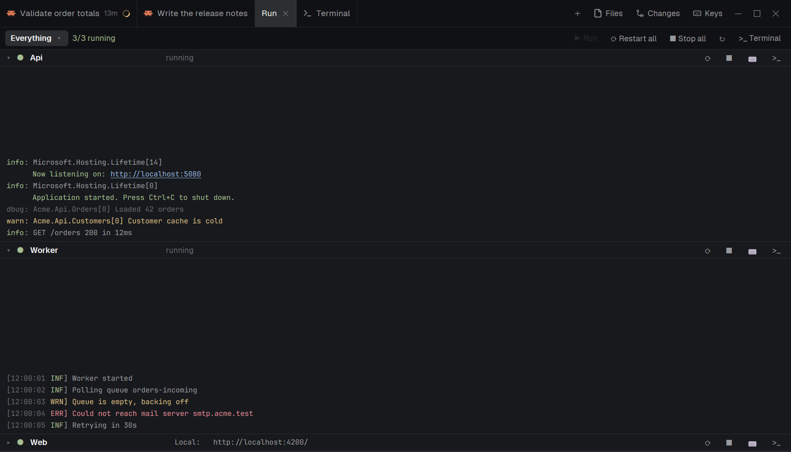
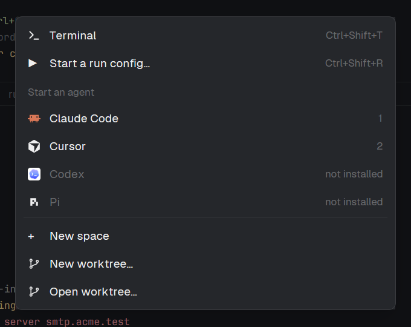

# Run Configurations

A Run tab for Herdr: start the JetBrains run configurations of your project, the API, the web app, the worker, and follow the output of each next to your agents. No IDE needed.

## What you get

- **Your run configurations**, read from the `.run` folder of the project (`.run/*.run.xml`, the files Rider, WebStorm and IntelliJ share through git). Pick one and press Run.
- **Compounds.** A configuration that starts several others starts them all, each as its own process.
- **Output per process**, folded to its last line or unfolded to its newest lines. Scroll up in it to go back through the last 500 lines; `↓ Follow` returns to the end.
- **Colour by meaning.** Errors red, warnings yellow, debug lines dim, success lines green, URLs blue. Click a URL to open it in the browser.
- **Control per process and for all**: restart, stop, type a line into a running process, or open a terminal in its folder.
- **Favourites.** Star a configuration to keep it at the top of the list. The one you picked last is remembered per project.
- **Processes outlive the tab's view.** Switch tabs or spaces and they keep running; come back and the output is there. Closing the Run tab stops them.

It comes with a second mod, `run-menu`: Herdr's `+` menu with one more row, "Start a run config…".

## What it runs

| Kind of configuration | How it is run |
|---|---|
| .NET launch profile (`LaunchSettings`) | `dotnet run --no-build` with that profile, after one `dotnet build` for everything you start |
| Executable (`RunNativeExe`) | The program with its arguments, in its working directory |
| npm script | `yarn`, `pnpm` or `npm run <script>`, by the lock file next to `package.json` |
| Compound | Each of the above it names |

Other kinds are listed as skipped.

## Install

Ask your agent in Herdr:

> Read ~/.config/herdr-app/AGENTS.md, then add this mod: https://github.com/Cerbrus/herdr-mods/tree/master/run-configurations
>
> Read ~/.config/herdr-app/AGENTS.md, then add this mod: https://github.com/Cerbrus/herdr-mods/tree/master/timed-tabs
>
> Show timed-tabs in place of the tab bar.

Or with PowerShell, from a clone of this repository: `.\Install.ps1 run-configurations`.

It needs [Timed Tabs](../timed-tabs): that tab bar opens the menu, handles the key and makes a Run tab wait for its processes when you close it.

## Keys

| Key | Does |
|---|---|
| `ctrl-shift-r` | Shows the Run tab of this space, and opens one when there is none. It starts nothing |
| `ctrl-shift-w` | Closes the tab. A Run tab stops its processes first |

`ctrl-shift-w` is bound for the Borderless Layout only (`layout:borderless` in `keys.json`). In another layout that shows Timed Tabs, add it to that layout's section.

## Using it

1. Press `ctrl-shift-r`, or pick "Start a run config…" from the `+` in the tab bar.
2. Pick a configuration from the list. The star keeps it at the top.
3. Press **Run**. Click a process to unfold its output.

The tab looks for a `.run` folder in the folder of the pane you were in, then in each folder above it.

Closing the Run tab with its close button, a middle click or `ctrl-shift-w` says it is stopping and closes once every process has ended. Close it again and it does not wait. Closed any other way, or when Herdr quits, the processes are killed at once.

## Good to know

- **Windows only.** It runs configurations through `powershell`, `cmd.exe` and `dotnet`.
- **It runs your programs.** Whatever a run configuration in the project says is started when you press Run, as it would be in the IDE.
- Colours are not the program's own: Herdr does not hand those to a mod. Lines are coloured by what they say (`error`, `warn`, `info:`, `[12:00:01 INF]`).
- Environment variables set in a run configuration are not applied.

`RECIPE.md` has the full description for an agent that builds or changes the mod.
