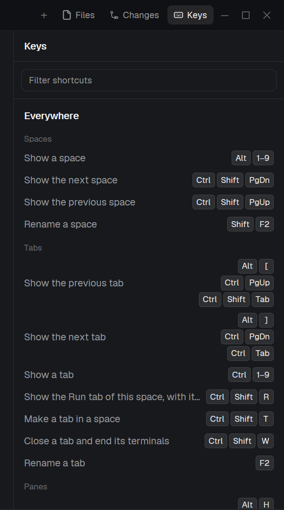

# Shortcuts

Every keyboard shortcut of your Herdr, in a panel next to your terminals. It reads your own `keys.json`, so it shows what your keys do, not what the defaults were.

## What you get

- **All your shortcuts**, grouped by where they work (everywhere, in a terminal, in one layout) and by what they act on: spaces, tabs, panes, agents, the terminal, the layout, the app.
- **In plain words.** Each one with Herdr's own description of the command: "Show the next space", not `space.next`.
- **A filter.** Type part of a description or a command name and the list narrows.
- **Always current.** Rebind a key and the panel shows it the next time it draws.
- Keys that do the same thing are shown together, and `alt-1` to `alt-9` become one row, `Alt 1–9`.

## Install

Ask your agent in Herdr:

> Read ~/.config/herdr-app/AGENTS.md, then add this mod: https://github.com/Cerbrus/herdr-mods/tree/master/shortcuts
>
> Read ~/.config/herdr-app/AGENTS.md, then add this mod: https://github.com/Cerbrus/herdr-mods/tree/master/timed-tabs
>
> Show timed-tabs in place of the tab bar, and add shortcuts to the side panel next to Files and Changes, as a block with id shortcuts.

Or with PowerShell, from a clone of this repository: `.\Install.ps1 shortcuts -Layout`, which also installs the [Borderless Layout](../borderless) that has the panel in place.

It needs [Timed Tabs](../timed-tabs): the Keys button that opens the panel is in that tab bar.

## Using it

Click **Keys** in the tab bar, next to Files and Changes. Click it again to close the panel. Like Files and Changes, the panel is remembered per space.

## Good to know

- It is a page of the side panel: a block with id `shortcuts` in the layout's `panel-body` stack. The Keys button only shows when the layout has that block.
- The filter matches descriptions, command names and keys. For a key, type its name as `keys.json` writes it: `pagedown`, `f2`.
- Commands of mods are listed under Other, by their name.

`RECIPE.md` has the full description for an agent that builds or changes the mod.
