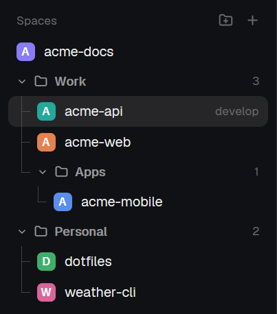

# Space Folders

The Spaces list of the Herdr sidebar as a tree: put your spaces in folders, nest the folders, fold what you are not working on.



## What you get

- **Folders for spaces**, up to three levels deep, each with a count of what is in it.
- **Fold a folder** with a click on its header. Go to a space inside a folded folder and the folder opens for as long as you are there, then folds again when you leave. Your folds only change when you click.
- **Drag and drop.** Drag a space onto a folder header, or onto a space in that folder, to put it there. Drag it onto a loose space, or below the list, to take it out. Drag a folder header onto another: the top or bottom edge puts it before or after, the middle puts it inside.
- **A menu on every folder** (right click): New space, New folder, Rename, Move to, Move up, Move down, Delete.
- **New spaces land where you ask.** "New space" in a folder's menu opens the [Project Picker](../project-picker), and the space you pick goes into that folder.

A space outside every folder is loose and shows above the folders. Inside a folder its spaces come first, then its subfolders. Everything else is Herdr's own list: the branch next to a space, worktrees under their repository, colours, the right-click menu of a space, other machines.

## Install

Ask your agent in Herdr:

```text
Read ~/.config/herdr-app/AGENTS.md, then add this mod: https://github.com/Cerbrus/herdr-mods/tree/master/space-folders

Read ~/.config/herdr-app/AGENTS.md, then add this mod: https://github.com/Cerbrus/herdr-mods/tree/master/project-picker

Show space-folders in place of the Spaces list.
```

Or with PowerShell, from a clone of this repository: `.\Install.ps1 space-folders`. Add `-Layout` to get the [Borderless Layout](../borderless) with it.

It needs the [Project Picker](../project-picker): the `+` in the header and "New space" in the folder menu open it.

## Using it

| To | Do this |
|---|---|
| Make a folder | The folder button next to `+` in the header. For one inside another: "New folder" in that folder's menu |
| Fill it | Drag spaces onto its header |
| Fold or unfold | Click the header |
| Rename, move or delete | Right click the header. Delete is only offered for a folder with no spaces in it or under it |

## Setting it up

Folders are made by hand, in the list. To start with some, name them in `mods/space-folders/config.js` before the first run, with a test that says which open spaces go in:

```js
export const SEED = [
  { name: "Work", takes: (space) => /^acme-/i.test(space.name ?? "") },
  { name: "Personal", takes: (space) => /[\\/]personal[\\/]/i.test(space.folder ?? "") },
];
```

`SEED` is used once, as long as no folder exists yet. After that the list is yours.

## Good to know

- Folders are for the spaces of this computer. Spaces on other machines keep Herdr's own grouping.
- The folders and what is in them are kept in Herdr's shared state (`spaces.folders` in `shared.json`), not in a file of the mod. Which folders are folded is kept per window.
- Spaces are reordered so that the spaces of a folder sit together.

`RECIPE.md` has the full description for an agent that builds or changes the mod.
