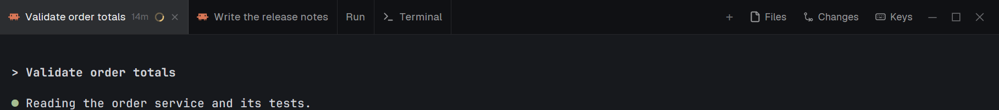

# Timed Tabs

Herdr's tab bar, with a timer on every tab whose agent is working.



## What you get

- **A timer on working tabs.** Next to the spinner: `<1m`, `14m`, `1h 5m`. You see at a glance which agent has been busy for a while.
- **Flat tabs.** Tabs fill the height of the bar and sit against each other, divided by a line, instead of floating pills.
- **A marker while you drag.** Drag a tab and a line shows where it lands; the dragged tab dims.
- **Middle click closes a tab.**
- **It picks up the other mods from this repository** when they are installed, and works without them:
  - The `+` opens the menu of [Run Configurations](../run-configurations), with its "Start a run config…" row. Otherwise Herdr's own menu.
  - A Keys button opens the [Shortcuts](../shortcuts) panel.
  - Closing a Run tab waits for its processes to stop.

The rest is Herdr's tab bar: click to select, double click to rename, right click for the menu, scroll to move through tabs, and the Files and Changes buttons.

## Install

Ask your agent in Herdr:

```text
Read ~/.config/herdr-app/AGENTS.md, then add this mod: https://github.com/Cerbrus/herdr-mods/tree/master/timed-tabs
```

Or with PowerShell, from a clone of this repository: `.\Install.ps1 timed-tabs`. Add `-Layout` to get the [Borderless Layout](../borderless) with it.

## Good to know

- **The timer is better with [Agent Cards](../agent-cards).** That mod records when each agent's status last changed and keeps it across restarts, and the tab bar uses it. On its own the bar counts from the moment it first saw the tab working, so a restart of Herdr starts the count again.
- **The flat tabs are drawn for a bar 42px high.** Herdr's own layout gives the tab bar 30px; the tabs fit, but lower.
- The Borderless Layout brings a tab bar with the same look and no timer, `borderless-tabs`, and shows this one instead once it is installed.
- A mod installed after the bar started is picked up when the bar reloads: switch layouts or restart Herdr.

`RECIPE.md` has the full description for an agent that builds or changes the mod.
